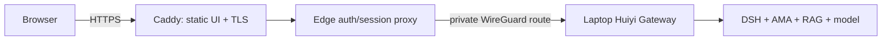

# Huiyi edge demo deployment package

**Current status: configuration and proxy unit tests only. This workstation's Docker Engine is unavailable, so Compose, HTTPS, browser login, SSE, and model-backed E2E have not been run. Do not mark this package `READY_TO_BUY_VPS` yet.**

## Boundary and topology

The edge package hosts the static clinical workstation, Caddy TLS ingress, and a small same-origin session-checking proxy. The laptop continues to host the Gateway, DSH, AMA Memory, local RAG/Health Engine, model route, and all synthetic patient/session state. No model weights, vector index, patient store, or database is included in the edge image. The browser login and patient authorization remain enforced by the Gateway; the edge proxy checks the Gateway session before forwarding protected APIs and passes SSE bytes through without buffering.



The login mode is the existing `clinical-evaluation` environment with synthetic accounts and synthetic patients. Its review action is a demonstration workflow event; it is not a physician approval or a production identity/EMR integration.

## Local Docker Desktop path

The local profile binds Caddy ports to loopback and uses Caddy's local CA. Docker Desktop and a running Gateway are prerequisites. Copy `.env.example` to `.env`, set the allowed browser origin on the Gateway to `https://localhost:8443`, and configure two synthetic-only Gateway accounts in `HUIYI_EVAL_USERS_JSON`. Keep `.env` ignored and never place real credentials there.

The Gateway executable defaults to `127.0.0.1`. For Docker Desktop's `host.docker.internal` bridge path, explicitly set `HUIYI_DEMO_BIND_HOST=0.0.0.0` and `HUIYI_ALLOW_WIDE_GATEWAY_BIND=1`; this is for a firewalled local synthetic demo only. If you cannot restrict host firewall access, do not use the wide bind. The public deployment binds the Gateway to its WireGuard address instead and does not use the wide-bind override.

Run the DSH/Health Engine/model route separately as described by the local runbook, then start the edge:

```powershell
Copy-Item deploy/edge-demo/.env.example deploy/edge-demo/.env
# Review deploy/edge-demo/.env and the synthetic Gateway environment first.
./deploy/edge-demo/scripts/up.ps1
./deploy/edge-demo/scripts/health.ps1
```

Open `https://localhost:8443`. The TLS warning is expected until the Caddy local CA is trusted on that machine. Test browser login, synthetic patient selection, patient switching, a single DSH question, evidence drawer, structured draft, demo review action, and logout. Use only synthetic data. Stop with `./deploy/edge-demo/scripts/down.ps1`; view infrastructure logs with `./deploy/edge-demo/scripts/logs.ps1`.

The proxy-only acceptance test is offline and needs Node 22, but not Docker, a model, or any network access:

```powershell
node --test deploy/edge-demo/proxy/server.test.mjs
```

It covers anonymous/revoked sessions, same-origin login, CSRF origin rejection, runtime provider metadata, security headers, and authenticated SSE pass-through against a synthetic mock Gateway. It does not substitute for the browser/Gateway/model acceptance path.

## Small Ubuntu VPS sequence

The VPS needs only this repository's deployment package, the static UI build, Docker/Compose, Caddy, the edge session proxy, WireGuard, firewall rules, and small operational logs. Keep RAG/Memory files, model files, DSH runtime, and patient records on the laptop. A two-vCPU / 2-GiB server is an edge-only target; build memory and runtime headroom still need measurement on the purchased host.

1. Clone the repository on Ubuntu and check out a reviewed commit. Build the frontend image and start `deploy/edge-demo/compose.yaml`; no medical corpus or model directory is copied.
2. Create WireGuard keys on each host and place them only in `/etc/wireguard/wg0.conf` and the laptop VPN configuration. Use `wireguard/*.example` as templates. Expose UDP 51820, TCP 80, and TCP 443 as needed. Do not publish TCP 8320.
3. Configure the server peer as `10.77.0.1/24` and laptop peer as `10.77.0.2/24`. The Caddy edge proxy points at `http://10.77.0.2:8320`; laptop Gateway binds specifically to `10.77.0.2`. Restrict laptop firewall ingress on 8320 to the WireGuard interface/source `10.77.0.1`.
4. Set `SITE_ADDRESS` and `HUIYI_PUBLIC_ORIGIN` to the real HTTPS hostname; clear `CADDY_TLS_DIRECTIVE` so Caddy can obtain/renew public certificates. Set `EDGE_BIND_ADDRESS=0.0.0.0`, `EDGE_HTTP_PORT=80`, and `EDGE_HTTPS_PORT=443` on the VPS.
5. Configure the Gateway's allowed origin to the public origin, secure cookie mode, real institution-approved identity and patient-context adapters before any real patient use. This repository's in-memory synthetic accounts are for a closed demo only.
6. Verify `wg show wg0`, `scripts/check-wireguard.sh wg0 10.77.0.2`, Caddy TLS renewal, and the edge health route. Test restart and laptop-offline behavior before sharing the hostname.

`CADDY_TLS_DIRECTIVE=tls internal` is for local development. The public host must use a real domain and automatic public ACME TLS; never put private keys or ACME account state in Git. Caddy `/data` and `/config` use named volumes so certificate/account state survives container restarts; `docker compose down -v` deletes those volumes and should be reserved for a full local reset.

## Rollback

Record the deployed Git commit before an update. To revert, ensure the clone has no uncommitted files, then run `./deploy/edge-demo/scripts/rollback.ps1 -Revision <known-good-sha>` (PowerShell) or check out the recorded commit on Ubuntu and run Compose again. Check the browser and `/healthz` before reopening traffic.

## Acceptance boundary

The edge package is not `READY_TO_BUY_VPS` until a local Docker run proves HTTPS ingress, Gateway login and patient switching, protected SSE, draft and review-action flow, logout/session revocation, a real GPT-6-Luna response, synthetic cross-patient isolation, restart/rollback, and bounded request/concurrency behavior. Cloud TLS, WireGuard, real SSO, persistent row-level authorization, or production EMR behavior must be measured separately and are not implied by local acceptance.
