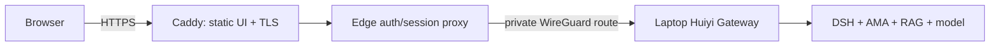

# Huiyi edge demo deployment package

> **Historical deployment candidate.** This Docker Compose + WireGuard package documents an earlier edge architecture and its 2026-10-12 local acceptance run. It is not the deployment currently exercised through the Ubuntu host. The active implementation is the Go service in `services/edge-gateway`, with the static bundle and SSH reverse tunnel described in that service's README. Use this file only when intentionally returning to the Compose/WireGuard candidate; its status and network checklist do not describe the live host.

**Local acceptance status: `READY_TO_BUY_VPS` for an edge-only synthetic demo.** On 2026-10-12 the Docker Compose edge, local HTTPS ingress, login, patient/Encounter switching, SSE, one GPT-6-Luna + local RAG browser request, draft review action, logout, and synthetic account isolation were exercised. This is not public deployment or production clinical readiness.

## Boundary and topology

The edge package hosts the static clinical workstation, Caddy TLS ingress, and a small same-origin session-checking proxy. The laptop continues to host the Gateway, DSH, AMA Memory, local RAG/Health Engine, model route, and all synthetic patient/session state. No model weights, vector index, patient store, or database is included in the edge image. The browser login and patient authorization remain enforced by the Gateway; the edge proxy checks the Gateway session before forwarding protected APIs and passes SSE bytes through without buffering.



The login mode is the existing `clinical-evaluation` environment with synthetic accounts and synthetic patients. Its review action is a demonstration workflow event; it is not a physician approval or a production identity/EMR integration.

## Local Docker Desktop path

The local profile binds Caddy ports to loopback and uses Caddy's local CA. Docker Desktop and a running Gateway are prerequisites. Copy `.env.example` to `.env`, set the allowed browser origin on the Gateway to `https://localhost:8443`, and configure two synthetic-only Gateway accounts in `HUIYI_EVAL_USERS_JSON`. Keep `.env` ignored and never place real credentials there.

Keep the Gateway bound to `127.0.0.1` on the development laptop. This workstation verified that the edge-auth container reaches the loopback Gateway through Docker Desktop's `host.docker.internal` route, so a wide host bind and firewall exception are not needed. On a purchased VPS deployment, bind the Gateway specifically to its WireGuard interface address; do not publish port 8320 publicly.

Run the DSH/Health Engine/model route separately as described by the local runbook, then start the edge:

```powershell
Copy-Item deploy/edge-demo/.env.example deploy/edge-demo/.env
# Review deploy/edge-demo/.env and the synthetic Gateway environment first.
./deploy/edge-demo/scripts/up.ps1
./deploy/edge-demo/scripts/health.ps1
```

Open `https://localhost:8443`. The local Caddy CA warning is expected until its root certificate is trusted on that machine. Use only the synthetic accounts and dataset. Stop with `./deploy/edge-demo/scripts/down.ps1`; view infrastructure logs with `./deploy/edge-demo/scripts/logs.ps1`.

The proxy-only acceptance test is offline and needs Node 22, but not Docker, a model, or any network access:

```powershell
node --test deploy/edge-demo/proxy/server.test.mjs
```

It covers anonymous/revoked sessions, same-origin login, CSRF origin rejection, runtime provider metadata, security headers, and authenticated SSE pass-through against a synthetic mock Gateway. It does not substitute for the browser/Gateway/model acceptance path.

## Small Ubuntu VPS sequence

The VPS needs only this repository's deployment package, the static UI build, Docker/Compose, Caddy, the edge session proxy, WireGuard, firewall rules, and small operational logs. Keep RAG/Memory files, model files, DSH runtime, and patient records on the laptop. A two-vCPU / 2-GiB server is an edge-only target; build memory and runtime headroom still need measurement on the purchased host.

1. Clone the repository on Ubuntu and check out a reviewed commit. Install the repository's Node.js/pnpm dependencies, run `pnpm --filter @huiyi/demo-web clinical-evaluation:build`, then build and start `deploy/edge-demo/compose.yaml`; no medical corpus or model directory is copied.
2. Create WireGuard keys on each host and place them only in `/etc/wireguard/wg0.conf` and the laptop VPN configuration. Use `wireguard/*.example` as templates. Expose UDP 51820, TCP 80, and TCP 443 as needed. Do not publish TCP 8320.
3. Configure the server peer as `10.77.0.1/24` and laptop peer as `10.77.0.2/24`. The Caddy edge proxy points at `http://10.77.0.2:8320`; laptop Gateway binds specifically to `10.77.0.2`. Restrict laptop firewall ingress on 8320 to the WireGuard interface/source `10.77.0.1`.
4. Set `SITE_ADDRESS` and `HUIYI_PUBLIC_ORIGIN` to the real HTTPS hostname; set `CADDY_CONFIG=/etc/caddy/Caddyfile.production` so Caddy can obtain/renew public certificates. Set `EDGE_BIND_ADDRESS=0.0.0.0`, `EDGE_HTTP_PORT=80`, and `EDGE_HTTPS_PORT=443` on the VPS.
5. Configure the Gateway's allowed origin to the public origin, secure cookie mode, real institution-approved identity and patient-context adapters before any real patient use. This repository's in-memory synthetic accounts are for a closed demo only.
6. Verify `wg show wg0`, `scripts/check-wireguard.sh wg0 10.77.0.2`, Caddy TLS renewal, and the edge health route. Test restart and laptop-offline behavior before sharing the hostname.

The local Caddyfile uses `tls internal`; the production Caddyfile leaves TLS to Caddy's automatic public ACME issuer. Select `/etc/caddy/Caddyfile.production` only with a real domain and public ports 80/443. Never put private keys or ACME account state in Git. Caddy `/data` and `/config` use named volumes so certificate/account state survives container restarts; `docker compose down -v` deletes those volumes and should be reserved for a full local reset.

## Rollback

Record the deployed Git commit before an update. To revert, ensure the clone has no uncommitted files, then run `./deploy/edge-demo/scripts/rollback.ps1 -Revision <known-good-sha>` (PowerShell) or check out the recorded commit on Ubuntu and run Compose again. Check the browser and `/healthz` before reopening traffic.

## Local acceptance record (2026-10-12)

- Two edge containers build and run: Caddy static HTTPS frontend and the Node edge-auth/SSE proxy. Host RAM at idle was approximately 57.6 MiB across these two containers.
- Browser path: login → synthetic patient switch → prior Encounter switch → one real GPT-6-Luna request through DSH and the local medical RAG index → 3 evidence items → structured draft → `需补充问诊` review state and audit entry → logout. Clinical approval was not performed.
- Real model request: 46.6 seconds end-to-end; first SSE body byte at 77.8 ms. This is one observed request, not a P95 estimate.
- Edge API: 10/10 patient-list reads succeeded at concurrency 10; 20/20 succeeded at concurrency 20. In this local run, login P95 was 392.02 ms (n=10) and patient-context read P95 was 10.18 ms (n=10).
- Isolation: a second synthetic account received HTTP 404 for the first account's patient context and for a chat using its own Session with the other account's patient. No model call was made for the denied probe.
- Failure path: an unreachable Gateway produced HTTP 502 at the edge proxy. Model-unavailable behavior is also covered by the Gateway backend tests; it was not induced in the live demo.
- `node --test deploy/edge-demo/proxy/server.test.mjs`: 5/5 passed. Frontend clinical-evaluation production build, production-copy check, Caddy configuration validation, and `docker compose config` passed.
- Screenshots and machine-readable HTTP metrics are saved under `artifacts/edge-demo/`. The browser recorder could not export video in this workstation session.

## Acceptance boundary

**`READY_TO_BUY_VPS` is met for the local, edge-only synthetic demo.** The package has a reusable Compose path, local HTTPS, auth/session checking, SSE pass-through, patient/Encounter authorization, a real model-backed synthetic browser path, and bounded HTTP concurrency evidence. Public DNS/ACME TLS, a live WireGuard tunnel, VPS restart and rollback, organization SSO, persistent row-level authorization, and real EMR integration remain post-purchase deployment checks. Do not imply public availability or production clinical use before those checks.
