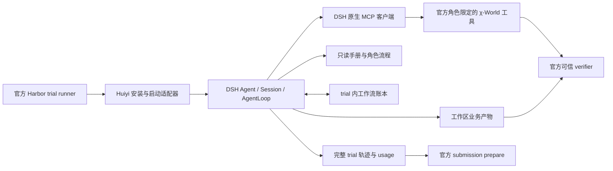

# Huiyi MedHarness 参加 χ-Bench：赛制、参考方案与改造方向

调研日期：2026-10-28，北京时间。本文是源码与规则调研报告，尚未运行 χ-Bench，文中目标与估算不代表实测比赛成绩。

**建议：将 Huiyi 扩展为“政策驱动的医疗业务执行 Agent”，保留 DSH 执行核心，新增独立参赛入口。首版以单 Agent、官方 MCP、按角色加载手册、可验证的业务状态推进为主。** 现有医学问答、文献 RAG、患者记忆和专科讨论只能提供局部能力；比赛的主要缺口是业务动作、流程终态和可复现提交。

## 1. 赛制与时间窗口

χ-Bench 让 Agent 在 χ-World 中执行美国医疗管理工作。公开开发集共 75 题，三类各 25 题；私有最终集预计约 75 题。任务目标需要通过业务工具和工作区产物完成，回答一段正确解释通常不构成任务完成。可使用自己的模型、框架和本地环境。[官方规则参考，第 2、6 节](https://github.com/actava-ai/chi-bench/blob/main/docs/competition-rules-draft.md)

| 领域 | 实际工作 | 对 Huiyi 的要求 |
|---|---|---|
| Provider PA：医疗提供方事前授权 | 核对患者和订单、整理病历证据、提交申请，处理补件、同行评审、申诉 | 能查询并修改业务系统，形成真实提交及后续处理记录 |
| Payer UM：医保方利用管理 | 受理申请、判断资格和适用政策、护士/医生审核、出具并送达决定 | 明确审核阶段、合法提前退出、升级路径及决定文书 |
| CM：护理管理 | 查看病历、联系模拟患者、开展评估、生成护理计划 | 实际完成多轮互动，保存评估与 NANDA-I/NOC/NIC 对应计划 |

来源：[官方规则参考](https://github.com/actava-ai/chi-bench/blob/main/docs/competition-rules-draft.md)、[官方任务说明](https://www.actava.ai/benchmarks/docs)。

### 评分与提交

每题采用严格二元 reward：所有必须且非 N/A 的检查通过才为 1；任一必要检查失败即为 0。检查包括确定性业务契约与 LLM rubric。fractional completion 只能用于诊断。私有评测每题运行三次：第一轮结果计算 pass@1，三轮全部成功才计入 pass³。排名依次比较 pass@1、pass³、推理成本和工具调用数；官方规则参考还列出更早的有效最终提交作为后续平分规则。[官方评分规则，第 9—12 节](https://github.com/actava-ai/chi-bench/blob/main/docs/competition-rules-draft.md)

注意两个容易混淆的数字：**同一 trial 内每条 rubric 的三次 Judge 投票**与**每题三个独立 Agent trial**不是同一件事。当前比赛配置要求 Judge 为 `claude-opus-4-7`，患者及 P2P 模拟使用 `claude-sonnet-5`；官方可能在冻结前宣布不可变替代 snapshot，需在正式运行时重新核对。[官方配置参考](https://github.com/actava-ai/chi-bench/blob/main/docs/kaggle-challenge-overview.md)

公开 Kaggle CSV 每题一行，列为 `task_id,reward`，共 75 行且 ID 不重不漏。它是参与者本地运行结果的临时声明，最终排名由主办方重跑私有任务决定。最终材料还包括 `cb submission prepare` 的证据包、Agent/编排源码、提示与配置、依赖锁文件、模型和端点标识、容器或完整复现步骤、成本记录，以及 IEEE 格式、不含参考文献最多五页的报告。[官方规则参考，第 9、11 节](https://github.com/actava-ai/chi-bench/blob/main/docs/competition-rules-draft.md)

| 事项 | 官方 UTC 日期，23:59 截止 | 北京时间 |
|---|---|---|
| 报名、组队合并 | 2026-11-07 | 2026-11-08 07:59 |
| 最终 CSV 与完整参赛包 | 2026-11-15 | 2026-11-16 07:59 |
| 结果公布 | 2026-11-23 | 以具体公告时刻为准 |
| 获奖队伍会议材料 | 2026-12-07 | 截止时刻仍需核对公告 |

这些日期来自[比赛 Overview](https://www.kaggle.com/competitions/chi-bench)和[官方仓库规则参考](https://github.com/actava-ai/chi-bench/blob/main/docs/competition-rules-draft.md)。官方参考转述提交说明：完整包在 11 月 15 日前投递 `research@actava.ai`，邮件主题含 `[Kaggle]` 和队伍信息；12 月 7 日用于获奖队伍会议材料。此轮没有发送邮件或提交参赛申请。

### 必须先解决的访问与规则事项

1. 手册是单独授权的 gated 数据，获批后才能运行比赛；访问手册的每位成员需要各自授权。手册文件及派生保密内容不得随代码、公开日志或公共镜像再分发。官方页面称通常一个工作日内回复，不能当作审批承诺。[手册访问条款](https://huggingface.co/datasets/actava/managed-care-operations-handbook)
2. 开发、调试可以有人参与，计分 trial 开始后必须自主执行；不能手动改动作、补产物、改 reward，不能给 Agent 看隐藏 expectations、solutions 或裁判文件。可编写通用业务流程，不能按 task ID 硬编码最终答案。[官方规则参考，第 7—8 节](https://github.com/actava-ai/chi-bench/blob/main/docs/competition-rules-draft.md)
3. 当前官方参考记载：最多五人组队，每日最多五次 Kaggle 提交；最终冻结同一套系统配置。API 开发成本由参赛者承担，私有评测 API 成本由主办方承担，后者是仓库对讨论帖的转述。[官方规则参考，第 4、9、11 节](https://github.com/actava-ai/chi-bench/blob/main/docs/competition-rules-draft.md)
4. **待重新核对：** Kaggle 标题写 2027，正文和规则参考写 2026；直接读取 Rules 和两条讨论帖未成功。仓库参考标明 10 月 6 日与 Kaggle 对齐，但 live Rules 和 Kaggle 基础规则具有更高效力。CSV/Writeup 与邮件的重复提交要求仍有未答追问。执行上按更早的 2026 日期安排，并同时准备 CSV 和完整包；正式报名时核对 live Rules。[规则来源说明](https://github.com/actava-ai/chi-bench/blob/main/docs/competition-rules-draft.md#source-notes)

## 2. 运行协议：要接入最新官方环境

本次读到的官方 `main` HEAD 为 **`7998d113d323f8b0a8a5bbcd065920356891fd38`**，2026-10-26 合并 runtime isolation 修复。运行时 1.1.0 与任务集 `chi-bench-v1.0.0` 是两个独立版本号。[官方提交](https://github.com/actava-ai/chi-bench/commit/7998d113d323f8b0a8a5bbcd065920356891fd38)、[更新记录](https://github.com/actava-ai/chi-bench/blob/main/CHANGELOG.md)

最新 source runner 由 Harbor 管理干净的 Agent 容器及可信 simulator/verifier 容器。Agent 仅接触指定角色的 MCP/业务 HTTP、被允许的输入、只读手册和工作区；隐藏数据库、裁判材料与控制 token 留在可信容器。评测前停止 Agent 并排空已接纳的工具调用，然后评分。不要将整个任务 `fixtures/` 当作可读输入，也不要用可写的工作区伪造导出状态。[运行架构](https://github.com/actava-ai/chi-bench/blob/main/docs/architecture.md)

准备数据时还需要官方 1.1.0 修复脚本及 payer 表单重建，并在完成准备后记录被接受数据的 `content_sha256`。后续内容不匹配应定位原因，不能重填哈希来绕过检查。最终需要冻结 runtime commit、数据版本和内容 hash、镜像 digest、Agent 源码/dirty 状态及模型配置。[官方 README](https://github.com/actava-ai/chi-bench)、[提交配置模板](https://github.com/actava-ai/chi-bench/blob/main/configs/submission_example.yaml)

新版 Judge 将裁判超时、缺失或不完整 verdict 标为 **invalid**，数值 0 只是 Harbor 传输占位；它不等于有效的 Agent 失败。聚合和打包会拒绝 invalid trial。重评输出与原结果分开，单独运行 rejudge 不会自动替换 canonical 结果。[Judge 契约](https://github.com/actava-ai/chi-bench/blob/main/docs/judge.md)

核心比赛只要求三个领域的 75 题。Marathon 和双角色 provider↔payer E2E 可作后续研究，不进入首版关键路径；当前 E2E 已转为 `workflow_v2`，与历史论文协议不能混比。官方网页还存在 20/21 个应用的描述差异，实际接入应以当前角色的工具发现结果为准。[官方 README](https://github.com/actava-ai/chi-bench)、[E2E 协议](https://github.com/actava-ai/chi-bench/blob/main/docs/judge.md#versioned-e2e-scoring)

## 3. 同赛题参考：先看可复核工件，再看榜单

官网榜单显示最后更新 2026-08-12，GitHub 证据仓库已有 9 月和 10 月新包。因此官网展示不能当作截至今天完整的最新排名。这些都是公开开发数据结果，不能当作本次私有决赛分数；不同 runtime、Judge、数据修订也会影响可比性。[榜单页面](https://www.actava.ai/benchmarks/leaderboards)、[提交目录](https://github.com/actava-ai/leaderboard/tree/main/benchmarks/chi-bench/submissions)

| 系统 | 公开包所报成绩 | 可借鉴之处及边界 |
|---|---|---|
| Erius + Claude Opus 5 | overall 54.7%；PA 72%、UM 36%、CM 56% | 专用医疗业务系统的参考上限；本次只核对了证据包，未获得其完整实现，不能臆测架构 |
| MedArise pa-codex-agent + GPT-5.5 | PA 68%，仅 25 题 | 可参考授权工作流和产物；不能将单赛道成绩写成 overall |
| U2MedFellow v6 + DeepSeek-v4-pro | overall 37.3%；PA/UM 各 24%，CM 64% | 表明应逐领域定位优势；提交记录 `code_dirty=true`，费用记为 0 不能据此认定免费 |
| HG Full75，10 月修订包 | 20/75，26.67%；PA 44%、UM 28%、CM 8% | 包记录维护者要求的定向重跑/重评及来源，说明版本与证据完整性同样重要 |

逐项来源：[Erius](https://github.com/actava-ai/leaderboard/blob/main/benchmarks/chi-bench/submissions/2026-07-26-erius-opus5/README.md)、[MedArise](https://github.com/actava-ai/leaderboard/blob/main/benchmarks/chi-bench/submissions/2026-06-09-pa-codex-agent-gpt-5-5/README.md)、[U2Med 成绩](https://github.com/actava-ai/leaderboard/blob/main/benchmarks/chi-bench/submissions/2026-09-23-u2med-hermes-deepseek-v4-pro-v6-all-u2/README.md)与[provenance](https://github.com/actava-ai/leaderboard/blob/main/benchmarks/chi-bench/submissions/2026-09-23-u2med-hermes-deepseek-v4-pro-v6-all-u2/submission.json)、[HG 修订包](https://github.com/actava-ai/leaderboard/blob/main/benchmarks/chi-bench/submissions/2026-10-06-hg-chi-full75-20261006/README.md)。

论文/README 中的 Claude Code + Opus 4.6、28.0% 是历史实验结果，不能当作当前最好成绩。比较自己的系统时，应在相同当前环境重新跑一组通用基线。[论文](https://arxiv.org/abs/2605.16679)、[官方 README](https://github.com/actava-ai/chi-bench)

### 最有价值的代码参考

- **官方 `openai_agents_harness.py` / runner：** 看容器安装、指令传入、Streamable HTTP MCP、超大工具输出落盘、工具名转换、usage 和 ATIF 导出。参考适配边界，Huiyi 仍用 DSH AgentLoop。[扩展指南](https://github.com/actava-ai/chi-bench/blob/main/docs/extending.md)、[参考 runner](https://github.com/actava-ai/chi-bench/blob/main/src/chi_bench/experiment/agents/openai_agents_runner.py)
- **官方 CLI harness：** 作为 Python `BaseInstalledAgent` 启动 Node/DSH CLI 的薄包装参考。Python 在这里负责容器生命周期与结果接线，不应再构造一套用户回合循环。[CLI harness](https://github.com/actava-ai/chi-bench/blob/main/src/chi_bench/experiment/agents/codex_cli_harness.py)
- **τ-bench / τ²-bench 系列：** 借鉴 policy、工具、用户模拟器和最终状态共同构成任务的评测思路。它不是美国医疗政策来源；当前仓库已升级，复现实验必须固定版本。[官方仓库](https://github.com/sierra-research/tau2-bench)
- **MedAgentBench：** 借鉴虚拟 EHR/FHIR 环境中的结构化查询和写入验收；业务范围不同于 PA/UM，不适合替换比赛工具。[官方仓库](https://github.com/stanfordmlgroup/MedAgentBench)
- **AgentClinic：** 借鉴患者沟通和逐步收集信息；核心仍偏诊断交互，不能覆盖保险审核与产物落地。[官方仓库](https://github.com/samuelschmidgall/agentclinic)

### 用户追加方案的取舍

追加方案提出的 Workflow Controller、Policy Evidence Gate 和 Workflow Skill Memory 与上述主线一致。工作流状态及政策绑定应沉淀为 Huiyi 产品能力，比赛只增加运行配置与薄协议入口，继续使用同一主仓库和 `main`，不维护长期衍生产品。

其中最值得补读的是 **Agent Workflow Memory（ICML 2025）**：从轨迹抽象可复用流程，再按需提供给 Agent。原论文实验针对网页任务，不能将其收益直接外推到 χ-Bench。建议在完成单 Agent 业务闭环后，只用允许的开发轨迹离线生成去实体化 SOP，冻结并版本化；每次 trial 清空患者/病例状态，避免跨重复试次答案缓存。[论文原文](https://proceedings.mlr.press/v267/wang25bx.html)

**Toolathlon** 可用于研究异构工具、长程执行、工作区产物与轨迹诊断；其官方仓库已发布 Verified 版本，借鉴实现时应固定版本。[官方项目](https://github.com/hkust-nlp/Toolathlon) **Self-RAG** 可启发检索与证据充分性判断，但原方法包含专门训练，普通 prompt 检索门控只能称工程适配。[原始实现](https://github.com/AkariAsai/self-rag)

AWM、分层/图检索和风险审阅均是候选方法，不应在首个官方有效 trial 之前全部实现。追加方案的分层开发/验证/holdout 思路可采纳，分割时还须按共享病例/模板分组；它们仍是公开任务，不构成真正私有测试。目标分数可作为研发门槛，无法据此预测夺冠。

## 4. 本地仓库审计：可以复用什么

合并前发现三个检出，属于同一 Git 仓库：原主目录 `aaf15a4`，`run-7ec` 为 `7ec67f9`，最新工作树为 **`c3050e1`**。远程已实际 fetch，`origin/main=28ba197`；它是 `c3050e1` 的祖先，最新工作树多出两个 H2 提交。`run-7ec` 也已被最新分支包含。最新目录还有前端、Gateway、部署文档、RAG 研究文档等未提交改动，不能只看 HEAD 就认为审计了全部内容。

用户随后要求统一检出。现已统一到主路径 **`D:\MyLab\harness\huiyi\Huiyi-MedHarness`**，另两个检出已清理，迁移验证覆盖 38,519 条记录、0 个哈希不匹配；5 个旧数据差异保留本地副本。完整整合与验证说明见 [合并记录](D:/MyLab/harness/huiyi/Huiyi-MedHarness/docs/maintenance/repository-consolidation-20261028.md)。旧版本恢复包、本地数据冲突副本保存在 `D:\MyLab\Jianli\artifacts\huiyi-consolidation-20261028`，不随参赛包上传。

| 能力 | 已核对的事实 | 参赛处理 |
|---|---|---|
| DSH 运行核心 | 固定 `5badb15009ae1756c3afe0ae0cef1faafc290ccc`；负责 Agent、Session、工具、取消及事件 | 保留；新增最小比赛 composition |
| MCP | 固定 DSH 上游已有 `@deepseek-ai/dsh-mcp-client`，支持 Streamable HTTP、schema 发现、取消和重连；Huiyi 当前 composition 未挂载 | 优先直接挂载官方客户端，先做兼容 smoke |
| 医学 RAG | Health Engine 有 Dense/FAISS 与有界迭代查询；契约保留来源 | 复用接口与来源约束，另建政策证据域 |
| H2 混合检索 | 离线评测 RRF+BGE 的 nDCG@10 为 0.693620→0.782991，n=182；BM25/RRF/Reranker 仍在 eval 分支 | 可迁移方法，需先产品化并在政策文档重评 |
| AMA 记忆 | 每 root turn 单次 recall、成功后提交；历史隔离评测未测得回答事实收益 | 首版关闭持久患者记忆，使用 trial 内账本 |
| MDAgents-derived 协作 | 有 DSH child 预算及结构化输出；当前 child `toolFilter={allow:[]}` | 可后续作只读审阅，不能直接充当跨系统业务角色 |
| 评测 | 已有源码指纹、病例隔离、恢复和 usage 机制 | 复用工程方法，比赛 reward 由官方 verifier 决定 |
| UI/边缘部署 | 已有工作台、SSE/Gateway、Go edge | 首轮比赛不依赖；后续可做任务回放界面 |

本地证据：[DSH composition](D:/MyLab/harness/huiyi/Huiyi-MedHarness/services/demo-gateway/src/backends/dsh-runtime.ts:220)、[能力安装](D:/MyLab/harness/huiyi/Huiyi-MedHarness/src/index.ts:39)、[H2 结论](D:/MyLab/harness/huiyi/Huiyi-MedHarness/docs/rag/H2-QUALITY-CLOSEOUT-20261016.md:7)、[子工具限制](D:/MyLab/harness/huiyi/Huiyi-MedHarness/src/collaboration/dsh-runner.ts:76)、[B3 局限](D:/MyLab/harness/huiyi/Huiyi-MedHarness/docs/eval/RESUME-B3-FINAL.md:20)。DSH MCP 源码已读：[README](D:/MyLab/harness/deepseek-harness/packages/mcp/mcp-client/README.md)、[transport](D:/MyLab/harness/deepseek-harness/packages/mcp/mcp-client/src/transport.ts)、[工具映射](D:/MyLab/harness/deepseek-harness/packages/mcp/mcp-client/src/tools.ts)。

### 几个会直接影响改造的代码细节

1. `HealthCaseState` 目前只有 query、patientMemory、externalEvidence 和 collaboration，没有业务角色、case/order ID、流程阶段、写操作回执或交付产物契约。[类型定义](D:/MyLab/harness/huiyi/Huiyi-MedHarness/src/case/contracts.ts:6)
2. Gateway prompt 以合成临床咨询、引用展示、医生复核为目标；比赛需要在授权模拟环境中自主推动流程。应新建比赛 prompt/composition，保留现有产品语义。[当前策略](D:/MyLab/harness/huiyi/Huiyi-MedHarness/services/demo-gateway/src/backends/dsh-runtime.ts:291)
3. 现有模型路由带本机 loopback 约束，Codex bridge 固定 `gpt-6-luna`；clinical-eval 也绑定该 route。正式包应采用明确、可移植的模型配置与主办方可调用凭证方案，不依赖当前桌面登录态。[路由](D:/MyLab/harness/huiyi/Huiyi-MedHarness/services/demo-gateway/src/backends/dsh-runtime.ts:342)
4. `capabilities.memory=false` 目前控制 memory 工具注册，`installMemoryLifecycle` 仍会被调用。要做到完全无 AMA，需独立 composition 或显式关闭 identity/recall/write，不能只依赖开关名称。[安装顺序](D:/MyLab/harness/huiyi/Huiyi-MedHarness/src/index.ts:47)
5. 通用 trace 是 metadata-only，不含完整提示、回答或工具内容，适合产品日志，但不够支撑比赛轨迹审计。需要单独的 trial 审计导出，并按手册授权要求处理内容。[trace](D:/MyLab/harness/huiyi/Huiyi-MedHarness/src/trace.ts:63)
6. H2 收尾报告不是服务已部署的证明；实际 `RagService` 仍使用 Dense retriever 与 iterative acquirer。不能把离线 Reranker 收益写成产品路径或比赛收益。[当前服务](D:/MyLab/harness/huiyi/Huiyi-MedHarness/services/health-engine/src/huiyi_health_engine/rag/service.py:67)

本机已实际只读确认 Docker Server **27.0.3**，WSL 有 **Ubuntu-24.04**。这证明容器基础设施可访问，不等于比赛镜像、手册授权、Judge key 或正式模型端点已准备完毕。调研没有读取密钥值、下载受限手册或启动付费比赛试验。

## 5. 建议架构：一个 DSH 外循环，显式业务状态



上图是建议实现；Harbor 负责环境与评分，Python adapter 负责安装/启动，DSH 负责唯一模型执行循环。内部 checklist、字段校验和终态校验是 DSH 的领域插件，不再引入另一套自主 AgentLoop。沿用已有 out-of-tree DSH 约束。

### P0-A：先接工具与工作区

新增薄的 `BaseInstalledAgent` 包装，向 Node/DSH runner 传入 instruction 文件、MCP URL、workspace、logs 与模型配置。安装 Node/pnpm 和锁定 DSH/Huiyi 依赖。单 trial 使用独立 Session、目录和身份；无需启动整套前端、Go edge 或临床 Gateway。[官方扩展契约](https://github.com/actava-ai/chi-bench/blob/main/docs/extending.md)

首选 DSH 原生 MCP 客户端，设 startup 必须可用并检查发现结果。特别验证：点号工具名会转换为 DSH 的 `mcp__...` 名称，丢失规范化信息时附 hash；必须保留 raw↔public 映射，调用时交回原始名称，不能自己猜工具名。[固定上游工具实现](D:/MyLab/harness/deepseek-harness/packages/mcp/mcp-client/src/tools.ts)

同时提供受工作区限制的文件读取/写入与 PDF 文本提取能力：手册和允许的输入只读，交付物只写 task workspace，完整长结果保留并给模型可读的路径/摘要。不要只复制现有 JSON 型医疗 EvidenceSet 后丢掉官方工具的结构化返回、文件或附件。

**验收：** 三个领域各一个任务成功启动、schema 发现、至少一次真实业务读写、回执复查、产物可读、正常退出并被官方 verifier 接收；允许 reward 为 0，但 invalid 必须归零。兼容性失败时再增加最小 adapter，不能预先重写 MCP 栈。

### P0-B：工作流账本与提交前检查

建议独立 `WorkflowCaseState`，不扩充患者长期记忆来代替流程状态：

```text
trialId / role / taskId
patientId / caseId / orderId / requestId
currentStage / applicablePolicyRefs
facts[{value, source, toolCallId, verifiedAt}]
pendingActions / unmetRequirements / outstandingDialogs
artifacts[{path, type, linkedCaseId, deliveryReceipt}]
actions[{toolCallId, operation, resultId, outcomeKnown}]
```

业务系统是权威状态，账本是本次执行缓存。每次重要写操作后读取回执或业务状态，确认完成后再推进。对超时的提交、签署、送达等写操作，先查询结果再决定补偿；不能因网络重连自动重发。只读请求可做有界重试，写操作按实际幂等条件处理。

各领域使用通用阶段模板：Provider 核实身份/订单→取证→表单/申请→响应/补件/申诉→合法终态；Payer 受理/资格→分流→适用审核→决定/文书/送达；CM 病历→真实外呼互动→评估→护理计划→保存。模板必须允许合法跳过和提前退出，不能强制每题走完所有阶段。只有缺失证据时，按政策采取补件、pend 或合理停止；不要把医学 RAG 的“拒答”直接当作业务任务终态。

终态检查仅使用 Agent 合法可见的政策、schema、工具状态和产物要求，检查同一主体/请求、必要字段、附件、签署、送达及未完成对话。**内部 completion check 不替代官方 verifier，也不读取隐藏 rubric。**

### P0-C：把手册、患者事实和外部文献分开

首版按手册公开约定：先读根索引，再打开当前角色子册及按需章节。手册约 1,279 个 Markdown 页面并含 PDF；medical-library 是查找型资料，不应整本注入上下文。[官方手册布局](https://huggingface.co/datasets/actava/managed-care-operations-handbook)

| 证据类型 | 权威来源 | 使用规则 |
|---|---|---|
| 患者与申请事实 | 官方病历、订单、业务工具及实际对话 | 不从文献或旧 trial 推断患者事实 |
| 保险与操作政策 | 当前任务适用 policy、授权手册 | 保留文档路径、版本、条款/段落；明确适用范围与冲突 |
| 外部医学文献 | 合法公开或自有检索资产 | 补充医学解释，不能覆盖具体保险规则 |

后续若角色目录查找不足，再迁移 H2 的 BM25/Dense/RRF/Reranker；先在政策章节建立独立 manifest、ID 和 provenance，新增适用条件字段。不要直接混入现有 82 万级医学 chunk，更不要预设检索 nDCG 提升会转成 strict pass@1 提升。

### P1：长程执行与有界审阅

固定 DSH 已有 compaction、工具结果裁剪和 token meter，可显式挂载，并按实际 context window 配置；其默认 headroom 不一定适合小窗口。压缩后必须保留业务 ID、政策引用、未知事实、写入回执、对话状态及产物路径。[固定版本 compaction](D:/MyLab/harness/deepseek-harness/packages/compaction/compaction-basic/README.md)

多 Agent 的首个实验应是独立的政策/产物审阅者，默认无业务写权限，给 root 返回缺项和证据。需要专门证明它增加 pass@1 或 pass³，且成本/时延可接受，才扩大使用。当前“临床复杂度→招募多个专科”不对应“业务阶段→不同法定职责”，二者不能直接互换。长期患者记忆、自训练、复杂群体协作、Marathon/E2E 均排在完成 75 题可提交闭环之后。

## 6. 最小改造文件边界

以下为建议位置，尚未实施：

| 路径 | 职责 |
|---|---|
| `integrations/chi-bench/huiyi_harness.py` | Harbor 安装/运行/工件适配 |
| `src/competition/runner.ts`、`composition.ts` | 独立 DSH root 配置、模型路由、MCP 和工作区 |
| `src/competition/workflow-state.ts`、`completion.ts` | 角色状态、动作回执与可见终态检查 |
| `src/competition/skills.ts` | 授权手册按角色加载及引用 |
| `src/competition/audit.ts` | DSH 事件到 trial 轨迹、usage 和 ATIF |
| `configs/chi-bench/*.example.*` | 环境变量占位、模型与预算，避免密钥入库 |
| `eval/chi-bench/` | 官方结果诊断、固定开发切片与消融 |
| `docs/adr/` | DSH/MCP/Harbor 边界及数据/日志约束 |

官方 adapter 的 registry entry、环境变量 allowlist 和容器构建接线可以作为最小 patch 提供给官方源码；不改 simulator、verifier 或任务数据来适应 Agent。自定义 Agent 不要求先向上游合并 PR。[扩展指南](https://github.com/actava-ai/chi-bench/blob/main/docs/extending.md)

## 7. 评测、成本与提交证据

建议冻结如下消融，而不是一上来叠加全部已有能力：

| 实验 | 唯一主要增量 | 目的 |
|---|---|---|
| A | 通用官方 harness + 同一模型 | 当前协议下的参照 |
| B | Huiyi/DSH + 官方 MCP + 手册 | 判断适配损耗 |
| C | B + 工作流账本与终态检查 | 检验核心改造假设 |
| D，可选 | C + 政策检索或单个审阅者 | 分别验证收益，避免混杂 |

先选每领域三题，覆盖读写、互动、补件/提前退出等公开任务类型，形成 9 题固定开发切片。保留其余公开题作内部回归集，明确它们仍是公共数据，不能称官方私有测试。A/B/C 各单次需 27 个 trial；候选在 9 题各跑三次再需 27 个。全 75 题一遍需 75 个，完整三遍可靠性评测需 225 个。是否完成全部扩展由 pilot 实际耗时、失败率和预算决定；正式 CSV 使用预先指定的单次运行，不挑选多次中的最好结果。

指标同时报告 overall/每领域 pass@1、pass³、有效 trial 数、invalid 数、首个失败阶段、工具错误、缺失产物、时延分位数及 agent tokens/cost。开销拆成 Agent、Judge、患者/P2P simulator 和容器资源，缺 usage 时填 unknown/null，不能填 0。用 9 题 pilot 的实际数据估算：`总预算 = Agent + Judge/投票 + simulator + 基础设施 + 预留重试`。[包的成本与 provenance 约定](https://github.com/actava-ai/chi-bench/blob/main/docs/submission-packet.md)

保留完整私有 trial 审计与对外证据导出两层：前者用于定位缺陷，后者符合官方 packet 契约并经过内容检查。ATIF 便于 usage 和轨迹复核；只开 metadata observer 不够。手册正文、派生保密内容和凭证不能因此进入公共包。公开 GitHub evidence leaderboard 与 Kaggle 决赛私有投递是两条流程，前者不替代后者。[提交包契约](https://github.com/actava-ai/chi-bench/blob/main/docs/submission-packet.md)、[官方规则参考](https://github.com/actava-ai/chi-bench/blob/main/docs/competition-rules-draft.md)

## 8. 按当前窗口的实施建议

下表是从 10 月 28 日起的建议安排，依赖手册授权和可用模型/Judge 接口，不是工期保证。

| 时间 | 交付与停止条件 |
|---|---|
| 10/28—10/29 | 统一仓库；确认 live Rules、报名与手册申请；冻结官方版本/数据准备方案 |
| 10/30—11/02 | 最小 DSH/Harbor/MCP 接入；三个领域各一例可验证执行与工件打包 |
| 11/03—11/06 | 9 题固定切片；工作流账本、文书/附件/终态检查；形成 A/B/C 对照 |
| 11/07—11/10 | 覆盖全 75 题；按通用失败类型修复；报名/合队须赶在北京时间 11/08 07:59 前 |
| 11/11—11/13 | 候选可靠性测试、独立重建环境、成本与内容审计；技术报告同步完成 |
| 11/14—11/15 | 冻结版本、正式单次 75 题、CSV 与私有完整包；北京时间 11/16 07:59 前完成投递 |

如果在 11 月 2 日前还不能产出跨三个领域的有效 trial，优先缩减到官方工具直连、手册导航和单 Agent。政策 Dense/Reranker、长期记忆、多专家、自训练和 UI 均不应阻塞完整提交。

## 9. 调研边界与最终判断

本轮实际完成：公开规则与官方仓库阅读、当前提交/版本核验、公开同类证据包对照、本地三检出与关键源码审计、Docker/WSL 可用性检查。未读取受限手册正文，未运行比赛，未验证官方 key/模型可用性，未证明任何方法能提高 χ-Bench 分数。仓库整合和工程检查结果另列，避免把旧 smoke 当作本次验收。

**最值得投入的方向是：DSH 稳定执行 + 按角色政策导航 + 有来源的工作流账本 + 业务终态/产物检查。** 现有 RAG 为政策检索提供方法储备，协作为后续审阅实验提供基础；它们需要通过当前官方协议下的单变量对照，才能成为参赛优势。
